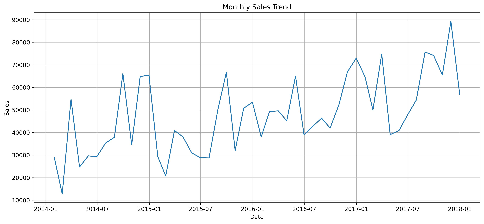
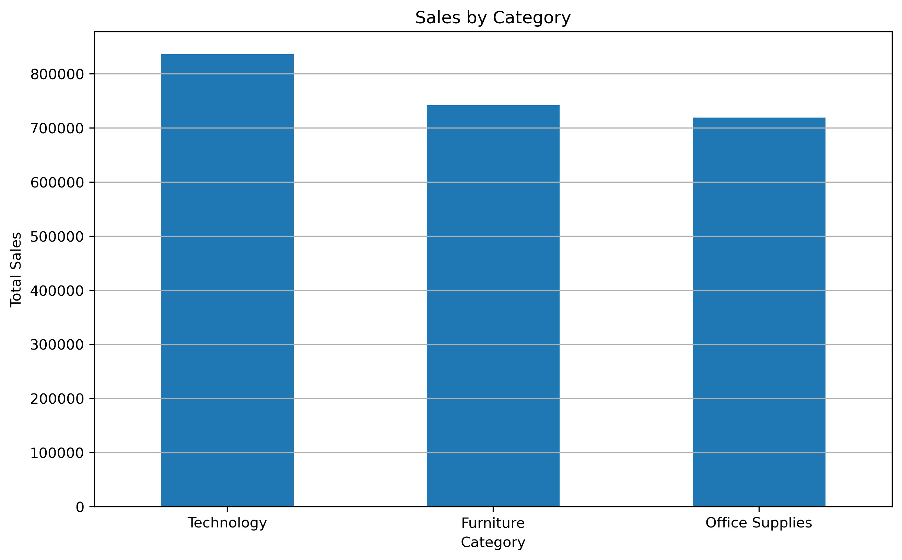
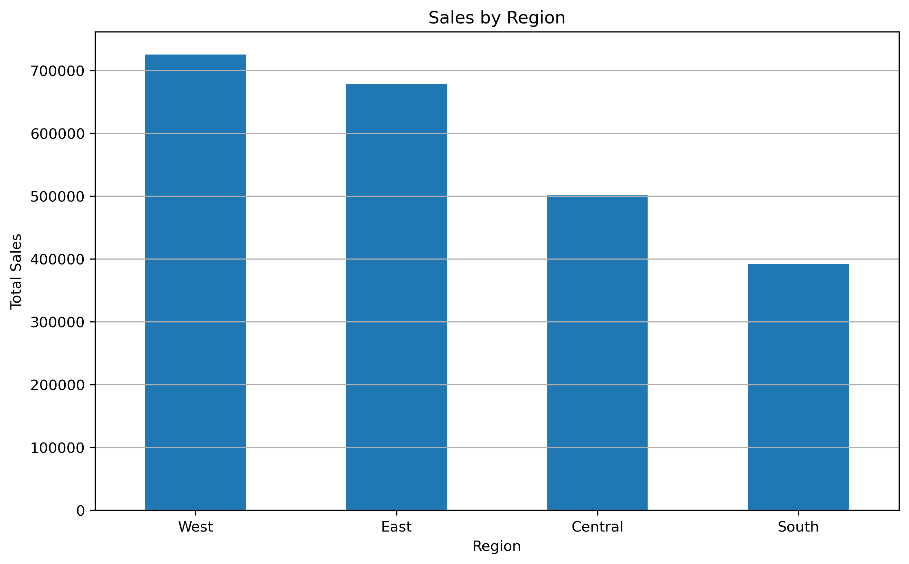
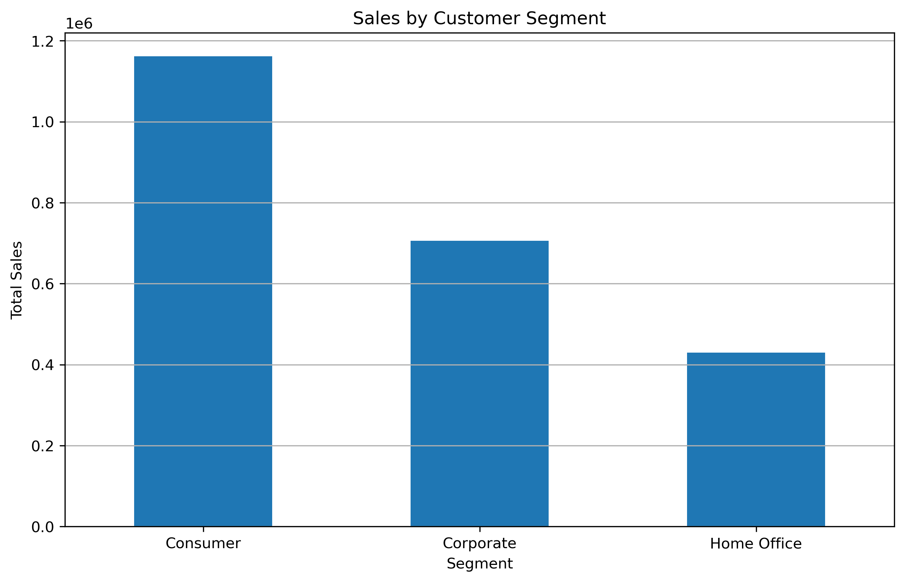
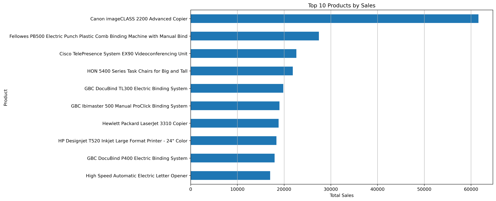
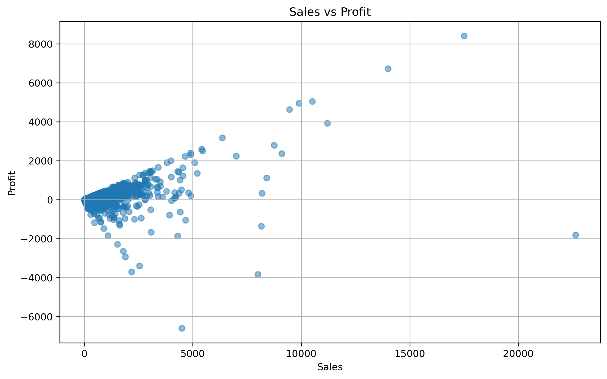
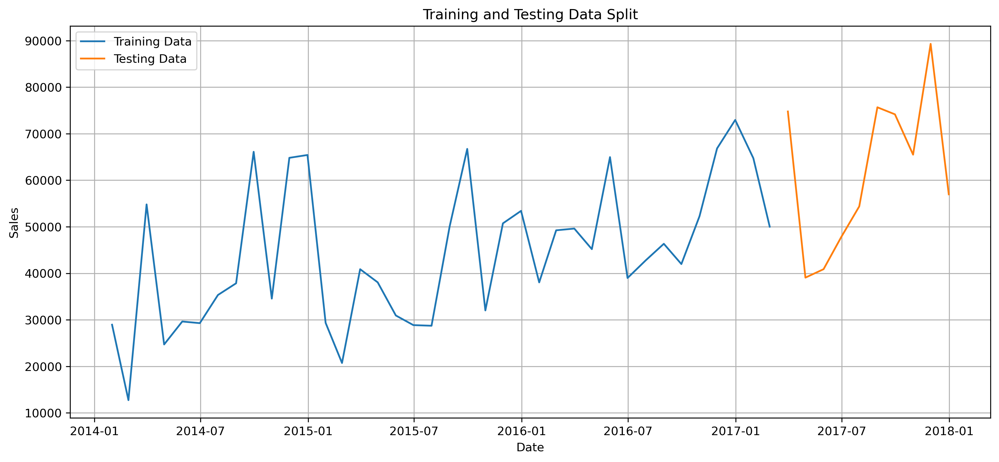
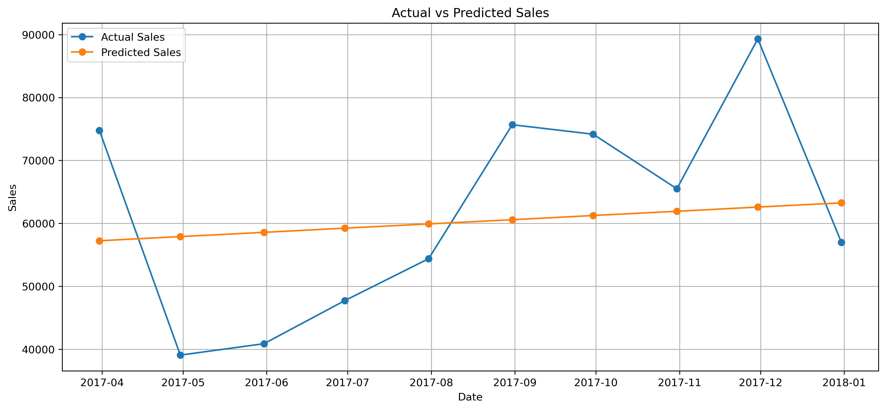
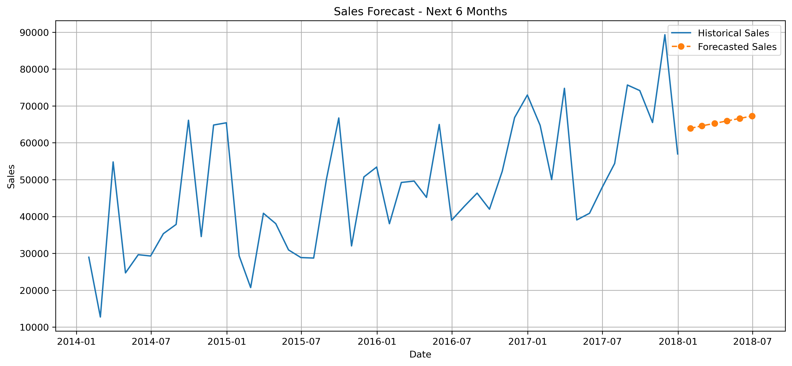

# 📈 Sales Forecasting System

A Python-based sales forecasting project that analyzes historical retail sales data, identifies business trends, and predicts future monthly sales using Linear Regression.

---

## 📌 Project Overview

The Sales Forecasting System uses historical sales transaction data to analyze sales performance and forecast future sales.

The project covers the complete data analytics workflow:

**Data Collection → Data Cleaning → Exploratory Data Analysis → Visualization → Forecasting → Model Evaluation → Business Insights**

---

## 🎯 Objectives

- Analyze historical sales data.
- Clean and preprocess business data.
- Analyze monthly and yearly sales trends.
- Identify high-performing categories, regions, segments, and products.
- Build a sales forecasting model using Linear Regression.
- Evaluate forecasting performance.
- Predict future monthly sales.
- Generate business insights and recommendations.

---

## 🛠️ Technologies Used

| Technology | Purpose |
|---|---|
| Python | Programming and analysis |
| Pandas | Data manipulation |
| NumPy | Numerical operations |
| Matplotlib | Data visualization |
| Seaborn | Statistical visualization |
| Scikit-learn | Machine learning |
| Jupyter Notebook | Interactive analysis |
| Git | Version control |
| GitHub | Project hosting |

---

## 📊 Dataset

The project uses a historical retail sales dataset containing information such as:

- Order Date
- Ship Date
- Customer
- Segment
- Region
- Category
- Sub-Category
- Product Name
- Sales
- Quantity
- Discount
- Profit

The dataset is used to analyze historical sales trends and prepare monthly sales data for forecasting.

---

## 🔄 Project Methodology

### 1. Data Collection

Historical retail sales data was collected from a publicly available online dataset.

### 2. Data Cleaning

The dataset was inspected for:

- Missing values
- Duplicate records
- Incorrect data types

The `Order Date` column was converted into datetime format.

### 3. Exploratory Data Analysis

The project analyzes:

- Monthly sales
- Yearly sales
- Sales by category
- Sales by region
- Sales by customer segment
- Top-selling products
- Sales and profit relationship

### 4. Forecasting

Monthly sales were aggregated and a sequential time index was created.

The data was divided into:

- 80% Training Data
- 20% Testing Data

A Linear Regression model was trained using historical monthly sales.

### 5. Model Evaluation

The model was evaluated using:

- MAE
- MSE
- RMSE
- R² Score

### 6. Future Forecasting

The trained model was used to predict sales for the next six months.

---

## 📈 Visualizations

### Monthly Sales Trend



### Sales by Category



### Sales by Region



### Sales by Customer Segment



### Top 10 Products



### Sales vs Profit



### Training and Testing Data



### Actual vs Predicted Sales



### Future Sales Forecast



---

## 📁 Project Structure

```text
SALES-FORECASTING-SYSTEM
│
├── charts
│   ├── monthly_sales_trend.png
│   ├── sales_by_category.png
│   ├── sales_by_region.png
│   ├── sales_by_segment.png
│   ├── top_10_products.png
│   ├── sales_vs_profit.png
│   ├── train_test_split.png
│   ├── actual_vs_predicted_sales.png
│   └── future_sales_forecast.png
│
├── dataset
│   ├── sales_data.csv
│   └── monthly_sales_forecasting.csv
│
├── notebooks
│   └── sales_forecasting_analysis.ipynb
│
├── reports
│   ├── business_insights.csv
│   ├── future_sales_forecast.csv
│   ├── model_evaluation.csv
│   └── sales_forecasting_business_report.md
│
├── README.md
